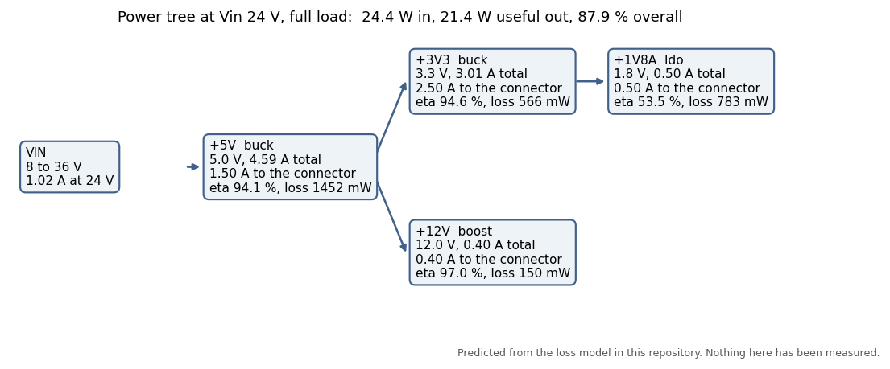
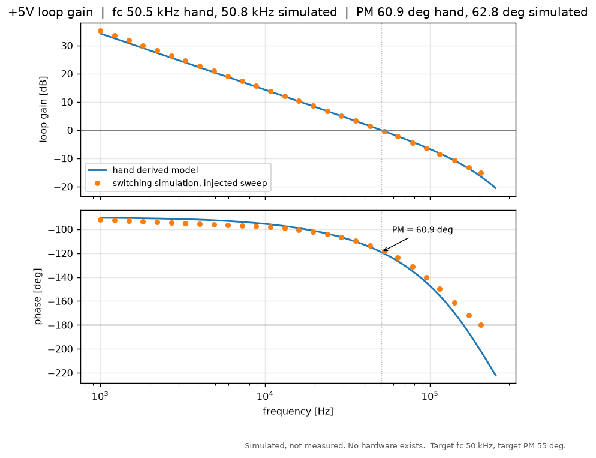
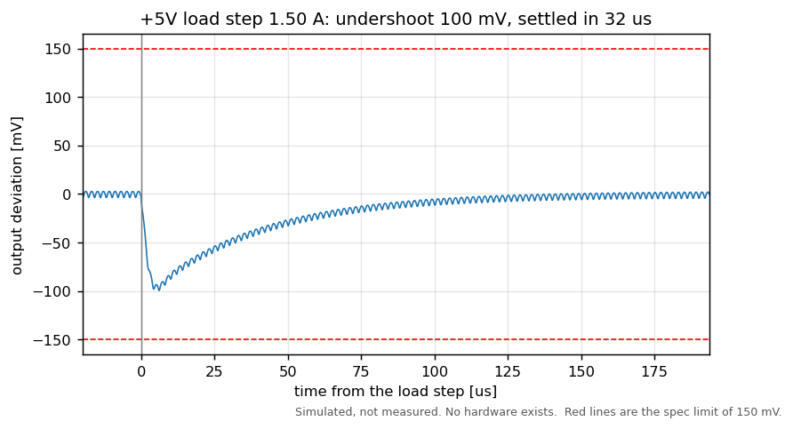
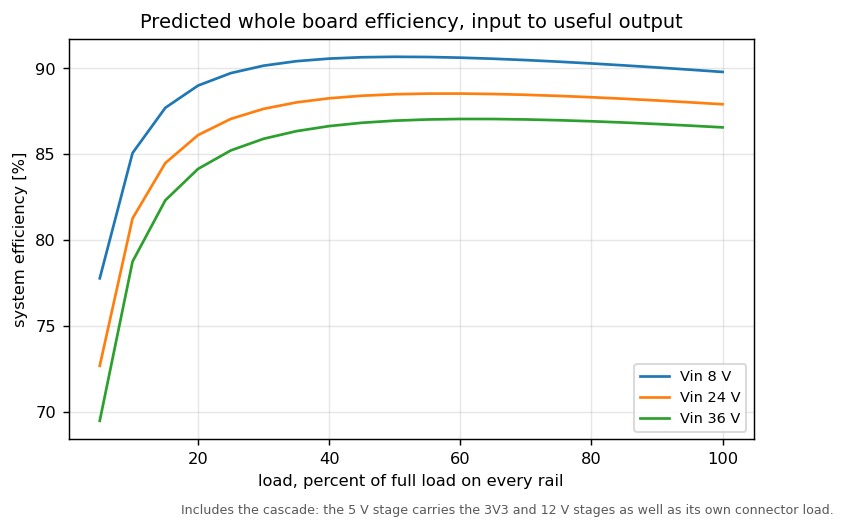
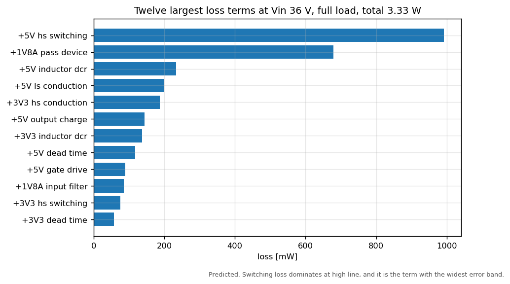
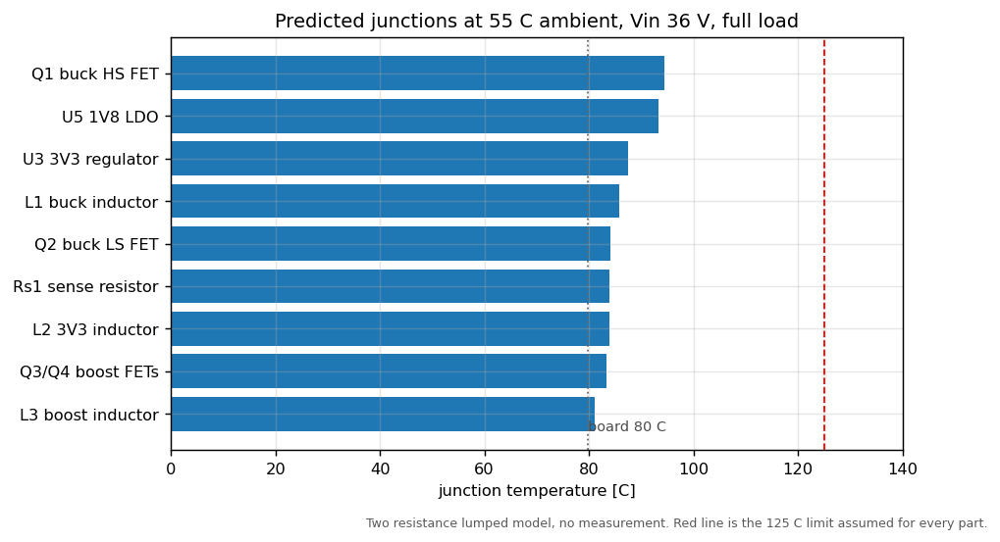
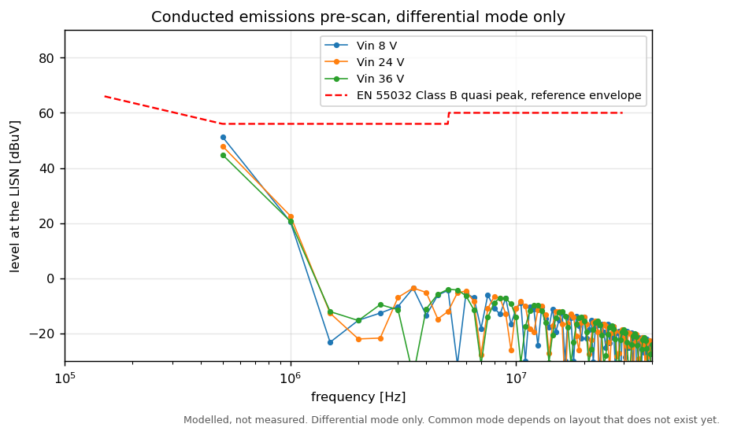

# emb-multirail-smps

> **Status: designed and validated in simulation, captured in KiCad. No
> hardware exists.** The electrical design is complete: specification,
> topology, sizing, hand derived loop compensation and a cycle accurate
> switching simulation that confirms the compensation gives the margins it was
> designed for. Real parts are selected, the schematic is captured in KiCad and
> held to the simulation by CI and a four layer board is laid out with five
> connections still unrouted and no layout review yet. **No board has been
> fabricated, assembled, powered or measured.** Everything under
> `test-results/` is computed. See [STATUS.md](STATUS.md) for the precise
> breakdown.

A four rail switch-mode supply for an 8 to 36 V DC input: a synchronous buck, a
second buck cascaded from it, a synchronous boost and a low noise LDO. 21.4 W
delivered at the connectors.



---

## The result this repository exists for

A schematic is a drawing. What makes a supply design worth reading is evidence
that the loop compensation derived on paper actually produces the crossover and
phase margin it claims. So this repository derives each loop by hand, then
measures the same loop off a switching simulation of the converter using the
same injection method a Bode analyser uses, and compares.

| rail | control | target fc | hand derived | simulated | error | target PM | hand derived | simulated | error |
|---|---|---|---|---|---|---|---|---|---|
| +5V | peak current mode | 50 kHz | 50.5 kHz | 50.8 kHz | +0.5 % | 55 deg | 60.9 deg | 62.8 deg | +1.9 deg |
| +3V3 | voltage mode | 100 kHz | 100.2 kHz | 99.1 kHz | -1.2 % | 55 deg | 63.3 deg | 65.9 deg | +2.6 deg |
| +12V | peak current mode | 6 kHz | 5.94 kHz | 6.26 kHz | +5.5 % | 50 deg | 76.6 deg | 78.3 deg | +1.7 deg |

Worst crossover disagreement 5.5 percent, worst phase margin disagreement 2.6
degrees. The brief this project was built to says not to order boards until the
simulation matches the hand calculation. It does.



The two traces are produced by code that shares nothing but the component
values. The hand derived line comes from state space averaging with the current
loop closed analytically; the points come from running the switching converter
cycle by cycle and measuring. They separate above about a fifth of the
switching frequency, which is exactly where an averaged model is supposed to
stop being accurate.

### A third opinion, from a tool that knows nothing about this repository

The hand derivation and the switching simulator are both mine, which is a
weakness: a shared misconception would agree with itself. So the compensator
networks are also emitted as **ngspice** decks and run on every push, with the
results compared against the closed forms.

ngspice is free, open source and the simulator inside KiCad. Each compensator
deck is passive components plus one ideal controlled source, so ngspice and
`smps.compensation` are solving the same linear system by completely different
means and have to agree to numerical precision. They do:

| deck | worst gain error | worst phase error |
|---|---|---|
| +5V Type II | 0.0000 dB | 0.000 deg |
| +12V Type II | 0.0000 dB | 0.000 deg |
| +3V3 Type III | 0.0001 dB | 0.099 deg |
| input filter | 0.0000 dB | magnitude only |

The enforced tolerance is 0.01 dB and 0.2 degrees, set just above what is
achieved rather than at a comfortable round number, so it is a guarantee rather
than somewhere for drift to hide. The 0.099 degrees is the whole of the
disagreement and it is explained: the deck's amplifier has a gain of a million
and the closed form it is compared against has an infinite one.

The switching deck is also run. ngspice settles the +3V3 rail at **3.3210 V**
against the 3.3210 V the feedback divider asks for, and reads 4.23 mVpp of
ripple against 2.74 mVpp from the simulator here. That factor of 1.54 is close
to the 1.6 the check allows, and it grew from 1.41 when the TPS54317's 0.891 V
reference replaced the assumed 0.8 V. The two are compared against
each other rather than only against the 20 mVpp limit, because both can sit
under a limit while disagreeing by a factor of two, and that disagreement is
the interesting number.

LTspice decks are emitted too, in a separate directory, and **have never been
run**: it is a Windows and Mac GUI with no Linux package, so no runner can
execute it. The two dialects are genuinely not interchangeable, which an
earlier version of this repository wrongly claimed; `Rser=`, `IF()` and
`LIMIT()` are LTspice extensions that ngspice rejects, and a test now asserts
none of them reaches an ngspice deck.

### The schematic is the circuit that was simulated

The brief named Altium; the schematic and board are in KiCad 8 instead, in
[`hardware/kicad/`](hardware/kicad/). Every part has a real part number and
footprint: LTC3891, TPS54317, TPS43061 and LP5912-1.8 for the four rails,
with the inductors, shunts and capacitors the simulation was sized for. Each
controller's reference and error amplifier figures came from its data sheet
into the model and the compensation was re-derived with them; the tables
above are the result.

CI runs `kicad-cli` in a pinned KiCad image on every push:

| check | result |
|---|---|
| ERC, every severity | 0 errors, 0 warnings |
| exported netlist against the ngspice decks, the models, the compensation table and each rail's set point | 575 checks, 0 failures |
| DRC with schematic parity on the four layer board | 0 clearance, short or parity errors; 5 connections unrouted |

The cross-check is the point. Every R, L and C in every deck ngspice runs is
matched to the schematic part it stands for, by value after the DC bias
derating the model applies and by the nets it joins, so a value changed in
KiCad fails the build. The board is generated placement and autorouted copper
on the [`docs/stackup.md`](docs/stackup.md) stackup. It is DRC clean apart
from the five open connections listed in STATUS.md and has not been through
the review in [`docs/layout_rules.md`](docs/layout_rules.md), so it is a
starting point, not a board to order.

---

## Run it

```bash
pip install -r requirements.txt
make demo
```

About two minutes. It regenerates every plot, CSV and generated document in the
repository from the specification and the component values. Nothing under
`outputs/`, `test-results/`, `docs/spec.md` or `docs/validation_report.md` is
written by hand.

```bash
make test
```

129 tests, about a minute, no hardware needed. One of them skips unless
ngspice is installed; CI installs it. They include a set that reads the
generated CSVs back and fails if any number quoted in this README has drifted
away from them.

```bash
make check
```

Runs the tests, regenerates everything and fails if what is committed has
drifted from what the code produces. This is the check to run before
committing, and it is the check that matters most: a repository full of
committed CSVs that no longer match the code is worse than one with no CSVs at
all, because it looks authoritative.

### CI

One job, which does six things in order: runs the tests, regenerates every
output, checks the regenerated results still match what is committed, runs the
generated decks in **ngspice** and compares them against the Python models,
checks that every number this README quotes is still true and runs the
**KiCad** ERC, netlist cross-check and DRC. `make ci` runs the same sequence
locally; `make kicad` runs the KiCad part alone, with Docker.

It is built to be cheap, because the account that runs it is a free one:

| | |
|---|---|
| one job, not four | the checkout and the dependency install are paid for once and shared, rather than each check renting its own runner |
| path filters | a commit that only touches documentation does not start a runner at all |
| concurrency | pushing twice in a minute cancels the first run instead of paying for both |
| pip cache | the dependency install is the second largest cost after the simulation |
| `timeout-minutes` | a hung job cannot quietly consume a month's allowance |
| manual version matrix | 3.9 and 3.11 are checked on demand, not on every push, because what that catches is library behaviour and that does not change when this repository does. 3.12 runs on every push as the main job's interpreter |

Measured at about 2 minutes per push, against roughly 12 for the obvious
arrangement of one job per check.

**The outputs are compared as numbers, not as bytes.** A switching simulation
that finds its switching instants by iteration is not bit reproducible across
platforms: these settled voltages agree to about one part per million between
Windows with numpy 1.26 and Linux with numpy 2.5. That is three orders finer
than any claim made here, and insisting on bit equality would fail the build
for reasons that have nothing to do with the design. Every non-numeric token
still has to match exactly, so a renamed column, a reordered row or a changed
sentence is caught. `scripts/check_outputs_current.py` does the comparison and
always prints the worst deviation it saw, so drift is visible long before it
trips the threshold.

---

## The rails

| rail | topology | control | Vin | Vout | Iout | to connector | fsw |
|---|---|---|---|---|---|---|---|
| +5V | synchronous buck | peak current mode | 8 to 36 V | 5.0 V | 5.0 A | 1.5 A | 500 kHz |
| +3V3 | synchronous buck | voltage mode | +5V | 3.3 V | 3.0 A | 2.5 A | 1 MHz |
| +12V | synchronous boost | peak current mode | +5V | 12.0 V | 0.4 A | 0.4 A | 400 kHz |
| +1V8A | LDO | linear | +3V3 | 1.8 V | 0.5 A | 0.5 A | - |

The rails are cascaded rather than independent, so the +5V stage carries 4.6 A
when only 1.5 A of that reaches a connector. Working the tree backwards by hand
is where a power budget usually goes wrong, so it is done by code and asserted
in the tests. Full specification and the reasoning for the tree, the control
schemes and the switching frequencies: [`docs/spec.md`](docs/spec.md) and
[`docs/design_notes.md`](docs/design_notes.md).

---

## What is here

| | |
|---|---|
| [`docs/spec.md`](docs/spec.md) | The specification. Generated from `simulation/smps/spec.py`, which is the only place these numbers are written down |
| [`docs/design_notes.md`](docs/design_notes.md) | Why this power tree and these control schemes, sizing worked by hand, and the closed forms the numeric models are checked against |
| [`docs/compensation/`](docs/compensation/) | One file per loop, with the placement rules argued and the arithmetic written out |
| [`docs/validation_report.md`](docs/validation_report.md) | Generated. Every result in one place, with what was checked and what was not |
| [`docs/loss_model.md`](docs/loss_model.md) | Every loss term, and how wrong each one is likely to be |
| [`docs/thermal_model.md`](docs/thermal_model.md) | The two resistance model, and what it cannot say |
| [`docs/emc_prescan_method.md`](docs/emc_prescan_method.md) | The conducted emissions model, the limit line's status, and the input filter stability trade-off |
| [`docs/stackup.md`](docs/stackup.md) | Four layer stackup and fabrication notes |
| [`docs/layout_rules.md`](docs/layout_rules.md) | The constraints a layout has to satisfy for any of these results to mean anything |
| [`docs/bring_up.md`](docs/bring_up.md) | Bring-up procedure with a predicted value for every measurement. Not performed |
| [`hardware/kicad/`](hardware/kicad/) | KiCad 8 schematic and four layer board, with the custom symbols, net classes and design rules |
| [`outputs/`](outputs/) | Protel netlist for Altium, SPICE decks in both ngspice and LTspice dialects, BOM with part numbers, compensation values and the verification checklist |
| [`test-results/`](test-results/) | Simulated Bode, regulation, transient, efficiency, thermal and EMC results |
| [`simulation/smps/`](simulation/smps/) | The models. State space averaging, current mode loop closure, compensator design, the switching simulator and the virtual network analyser |

---

## How the loop measurement works

The interesting part of the simulator is not that it switches, it is how the
loop gain comes out of it.

A small sinusoid is injected in series with the feedback divider. The voltage
either side of the injection is recorded and the loop gain is `-VA/VB`, which
is the formula a Bode 100 uses. Three details make it clean:

**Commensurate frequencies.** Every sweep point is snapped to `fsw * k/M` and
exactly `M` switching cycles are recorded. The switching ripple is periodic at
`fsw`, so in a once-per-cycle sample sequence it lands entirely on the DC bin
and the transform at bin `k` rejects it *exactly*. No windowing, no averaging,
no leakage.

**A continuous stimulus.** The injection is generated by a two state oscillator
inside the simulated system rather than by a value held constant across each
switching cycle. A held value is a zero order hold, and it would add
`exp(-s Ts/2)` of phase lag to the answer that the real converter does not
have. On the +5V rail that artefact is 18 degrees at crossover, which is the
difference between a comfortable design and a marginal one. It was found by the
sim and the hand model disagreeing, and it was the sim that was wrong.

**A linearity check.** Every measurement is re-run at double amplitude; the
answer moves by around one part in ten thousand. That is the same check a
careful bench sweep does.

The measurement has the same limitation a real analyser triggered off the
switching clock has: sampling once per cycle puts a Nyquist limit at `fsw/2`,
so on two of the three rails the simulated sweep cannot reach the -180 degree
crossing and the gain margin is reported from the hand model only. That is
stated rather than papered over.

---

## Results

Every number below is produced by `make demo`. **All of them are simulated.**

### Regulation, ripple and transient

| rail | line regulation | load regulation | ripple | limit | load step | undershoot | limit |
|---|---|---|---|---|---|---|---|
| +5V | < 0.001 % over 8 to 36 V | 0.001 % | 6.4 mVpp | 25 mVpp | 1.5 A | 99 mV | 150 mV |
| +3V3 | < 0.001 % over the 5 V band | < 0.001 % | 2.7 mVpp | 20 mVpp | 1.0 A | 43 mV | 100 mV |
| +12V | 0.001 % over the 5 V band | 0.001 % | 25.7 mVpp | 50 mVpp | 0.2 A | 198 mV | 300 mV |

The regulation columns are quoted to three decimals of a percent and no further,
because that is where this solver stops meaning anything: it resolves a settled
output voltage to about one part per million, which is 0.0001 percent. Read them
as bounds, not as measurements of a converter that regulates to a part in
a hundred thousand.

The +5V line regulation looks too good, and there is a reason. With peak
current mode and the artificial ramp set equal to the falling inductor current
slope, the modulator gain goes as `1/Vin` while the control to output gain goes
as `Vin`, and the two cancel exactly in the averaged model. The test suite
asserts that cancellation to one part in a million, precisely so a reader who
suspects a bug can see it was checked. The real converter will not be perfectly
flat: dead time, gate driver timing and Rds(on) all move with operating point
and none of them are modelled.



### Efficiency

87.9 percent at 24 V and full load, input to useful output, including the cost
of the cascade. 24.4 W in, 21.4 W out, 2.95 W of loss.



At high line the +5V stage is dominated by switching loss, not conduction loss.
That is also the loss term with the widest error band, so if a bench
measurement ever disagrees with this curve, it is the first place to look.



### Thermal

3.3 W in still air, no heatsink, on a 100 by 80 mm four layer board. The high
side buck FET runs hottest at high line, 94.4 C junction against a 125 C limit,
and the LDO is second at 93.4 C. A linear regulator dropping 1.5 V at 0.5 A has
to put 0.68 W somewhere, and on a board with no heatsink that puts it in the
same league as the switching FET carrying the whole supply.



Maximum ambient for a 125 degree junction at full load is 85.7 degrees at high
line, against a 55 degree specification.

### Conducted emissions and input filter stability



Differential mode only, against the EN 55032 Class B line used as a reference
envelope. Worst margin **4.7 dB**, at the switching fundamental at low line.
That is thin, and it is called out as the weakest claim here.

The same input filter is also checked against Middlebrook's criterion, because
a converter in regulation is a constant power load and looks like a negative
resistance below its loop bandwidth. Worst separation 14.6 dB. This is why the
bulk capacitor is 220 uF rather than the 47 uF the ripple alone would ask for,
and the test suite asserts that shrinking it fails.

---

## Limitations

The full list is in [STATUS.md](STATUS.md). The ones that matter most:

* **Nothing has been measured.** No board, no parts, no instruments. Every
  directory called `test-results` contains simulation output.
* **The layout is not finished.** Five connections are unrouted and the
  generated placement and autorouted copper have not been reviewed against
  `docs/layout_rules.md`. KiCad, not Altium.
* **Parts are selected, not fully verified.** Every part is real and its
  headline figures were checked; `outputs/VERIFY.csv` lists where the data
  sheets and the model still disagree. The +3V3 regulator's FET resistance and
  the input filter parts are the ones that matter most.
* **Common mode emissions are not modelled**, because they depend on the
  parasitics of a finished, reviewed layout. On real hardware common mode is very often the term that
  actually fails.
* **The LDO loop model is behavioural.** That rail's compensation lives inside
  the LP5912 and the model was not refitted to it. What this design controls
  there is the output capacitor, the preload and the input filter.
* **Discontinuous conduction is not modelled**, so the light load end of every
  efficiency curve is optimistic.
* **The thermal model assumes an isothermal board**, which it will not be.

---

## Licence

MIT. See [LICENSE](LICENSE).
